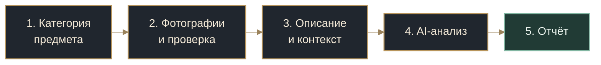
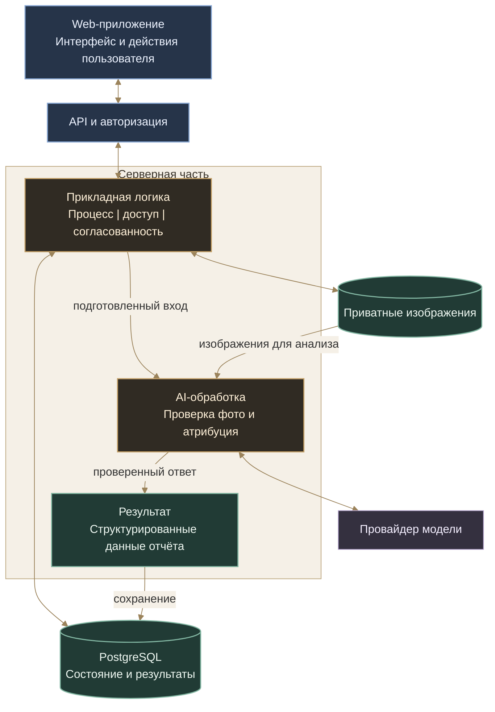
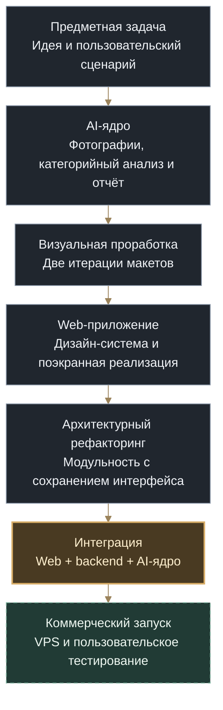

# Antique Attribution AI | устройство продукта

**От фотографий предмета — к структурированному AI-отчёту.**

[Обзор](README.md) | [Сценарий](#journey) | [Результат](#report) | [AI-процесс](#ai-process) | [Архитектура](#architecture) | [Путь создания](#development)

Antique Attribution AI объединяет предметный анализ, работу с изображениями и полноценное web-приложение. Пользователь подготавливает материал, получает обратную связь о фотографиях, добавляет сведения о предмете и переходит к отчёту.

Ниже показаны продуктовый сценарий и логическая архитектура объединённого сервиса. [Текущий этап разработки](README.md#status) вынесен отдельно.

---

## 1. Путь пользователя

Работа организована вокруг одного предмета: его фотографий, описания и результата. Пользователь видит последовательность действий, может возвращаться к подготовке материала и продолжать сохранённую работу.

**Подготовка фотографий.** Общий вид, детали, маркировки и состояние предмета рассматриваются как единый набор. Просмотр, поворот и обрезка встроены в рабочее пространство. Отдельная проверка качества помогает понять, достаточно ли материала и что стоит улучшить до основного анализа.

**Уточнение контекста.** Описание дополняет изображения: размеры, известная история, надписи и другие сведения помогают точнее поставить задачу. Перед запуском пользователь проверяет собранные материалы.

**Работа с результатом.** Отчёт соединяет изображения, характеристики, выводы и пояснения. История атрибуций и управляемая публикация продолжают этот сценарий: к результату можно вернуться или поделиться им.

Важный продуктовый принцип: **состав материала контролирует пользователь**. Проверка фотографий даёт рекомендации; изменение категории или выбранного набора остаётся осознанным действием.

## 2. Что получает пользователь

Результат — связанное описание конкретного предмета с опорой на предоставленные материалы. Его структура помогает отделить то, что видно на фотографиях, от интерпретации этих признаков.

| Содержание | Польза для дальнейшей работы |
|---|---|
| **Описание и характеристики** | Собрать сведения о предмете в одном месте: тип, материалы, конструкция и другие значимые для категории признаки |
| **Визуальные основания** | Понять, какие детали, надписи и особенности повлияли на вывод |
| **Предполагаемая атрибуция** | Получить версию происхождения, периода или назначения с пояснениями и обозначением уверенности |
| **Уточнения и дальнейшие шаги** | Увидеть, каких данных не хватает и на что обратить внимание при продолжении исследования |

Предметная структура меняется вместе с категорией: для часов важны одни признаки, для книги или иконы — другие. Общими остаются связь с исходными материалами, пояснение выводов и удобная форма чтения.

**Один сохранённый результат используется в отчёте, истории и публикации.** Повторное открытие показывает ту же работу, а не новый ответ модели. Владелец управляет доступом по ссылке; содержание отчёта остаётся связанным с исходной атрибуцией.

[Интерфейс рабочего пространства и отчёта →](README.md#interface)

## 3. Как устроена AI-обработка

AI-ядро разделяет оценку исходных фотографий и содержательную атрибуцию. Категория задаёт предметную структуру анализа; изображения и описание формируют контекст; ответ модели проходит программную проверку перед сохранением и представлением.

### Предметная специализация

Для разных категорий важны разные признаки. У часов — конструкция, циферблат и маркировки; у книги — издание, печать и переплёт; у иконы — изображение, материалы и техника исполнения. Общая инфраструктура анализа дополняется предметными спецификациями и типизированными форматами результата.

**Добавление категории расширяет предметную часть, сохраняя общий путь обработки.** Не требуется заново строить загрузку фотографий, авторизацию, хранение и пользовательское рабочее пространство. Спецификации и проверки каждой категории развиваются отдельно от общей инфраструктуры.

### Управляемый процесс

Модель отвечает за анализ. Приложение — за последовательность обработки, допустимые действия, проверку полученных данных и сохранение результата. Structured Outputs дополняются серверной валидацией через Pydantic.

Отображение отчёта строится из сохранённых структурированных данных. Поэтому предметный анализ, хранение и представление можно развивать независимо, сохраняя связь результата с конкретной работой пользователя.

## 4. Логическая архитектура

В основе — модульный Python backend с единым управлением состоянием продукта и независимым web-интерфейсом. Взаимодействие с моделью, хранение изображений и представление отчёта имеют отдельные границы ответственности.

### Web и сервер развиваются независимо

Frontend разделён на пользовательское представление, прикладное поведение и адаптеры источников данных. Это позволило отдельно проработать интерфейс, затем подключать серверные возможности, сохраняя привычные экраны и действия.

Серверная логика не привязана к конкретному клиентскому интерфейсу. Web — основа продукта; другие клиентские приложения могут использовать те же прикладные возможности через API.

### Состояние остаётся согласованным

Черновик, выбранные фотографии и результат имеют устойчивую связь. Сервер контролирует доступ и изменения, а клиент отображает подтверждённое состояние. Версии данных и явная передача редактирования защищают работу от конфликтующих действий в нескольких вкладках.

Повторная отправка команды и новое действие пользователя различаются. При потерянном ответе можно установить исход первоначальной операции, не создавая дублирующее изменение.

### Изображения отделены от способа хранения

Фотографии сохраняются приватно и выдаются после проверки доступа. Работа приложения с изображениями отделена от конкретной системы хранения. Это позволяет развивать инфраструктуру без изменения пользовательского сценария и предметной логики анализа.

### AI встроен в приложение

Провайдер модели — внешняя интеграция, а не владелец процесса. Подготовка входа, принятие результата и построение отчёта остаются в приложении. Разделение интерактивного API и длительной обработки задаёт основу дальнейшего серверного исполнения.

## 5. Решения на конкретных ситуациях

### Ответ модели относится не ко всем фотографиям

Для трёх отправленных снимков модель может вернуть три оценки, две из которых относятся к одному изображению. Одной проверки количества недостаточно: прежде чем применять результат, приложение проверяет полноту, уникальность и принадлежность оценок исходному набору.

**Практический смысл:** обратная связь остаётся привязанной к тем фотографиям, которые действительно отправил пользователь.

### Фотография сохранена, а ответ сервера потерян

После обрыва связи нельзя судить об исходе операции только по ошибке браузера. Повторное обращение связывается с первоначальной командой: сервер возвращает её подтверждённый результат, после чего интерфейс получает актуальное состояние.

**Практический смысл:** восстановление связи не создаёт дублирующую фотографию, а пользователь не должен начинать работу заново.

### Нужно изменить архитектуру уже созданного интерфейса

Web-приложение сначала было разработано по экранным макетам, затем прошло отдельный рефакторинг. Представление, прикладные действия и источники данных разделялись постепенно, с проверкой переходов, ввода, состояния и визуального поведения.

**Практический смысл:** серверные интеграции подключаются к подготовленным границам, а пользовательский опыт сохраняется при изменении внутреннего устройства.

### Осознанные архитектурные решения

| Решение | Зачем оно принято |
|---|---|
| **Модульный backend с общей моделью данных** | Разделять ответственность без преждевременного усложнения инфраструктуры |
| **Категорийные спецификации поверх общего AI-ядра** | Развивать предметную глубину, сохраняя общие обработку, проверки и хранение |
| **Самостоятельный Web с заменяемыми источниками данных** | Отдельно прорабатывать интерфейс и интеграции, сохраняя продукт между изменениями |
| **Приватное хранилище за отдельной границей** | Контролировать доступ к изображениям и менять способ хранения без переписывания анализа |

Проверки охватывают основной сценарий и нетипичные ситуации: повторы команд, конфликт редакторов, восстановление сохранённых материалов и отклонение некорректного ответа модели. Контрактные, интеграционные и браузерные проверки дополняются ручной приёмкой интерфейса.

## 6. От идеи к коммерческому продукту

Идея выросла из моего практического опыта работы с антиквариатом: для незнакомого предмета нужно собрать признаки, сопоставить фотографии и сведения, затем получить понятное исходное описание. Я последовательно развил эту задачу от AI-ядра до самостоятельного web-продукта.

**Ядро.** Выделены подготовка фотографий, проверка качества, предметный анализ, структура результата и рендеринг отчёта. Категории развиваются поверх общей инфраструктуры.

**Визуальная система и Web.** До реализации были проработаны сценарии и две версии экранных макетов. Затем созданы дизайн-система, рабочее пространство и связанные поверхности продукта.

**Рефакторинг.** Уже собранное приложение прошло отдельную архитектурную переработку. Основная задача — разделить ответственность, управление состоянием и внешние зависимости, сохранив интерфейс, переходы и пользовательское поведение.

**Интеграция и запуск.** Web, серверное состояние и AI-обработка соединяются через согласованные прикладные границы. Развёртывание на VPS продолжает ту же архитектуру; пользовательское тестирование и обратная связь направляют дальнейшее развитие.

## 7. Авторство и AI-assisted разработка

Проект создаю самостоятельно с использованием ИИ-инструментов — от идеи и предметной постановки до архитектуры, интерфейса, реализации и проверки результата.

В моей зоне ответственности: продуктовый сценарий, требования, архитектурные решения, экранные макеты и дизайн-система, декомпозиция работы, организация AI-assisted реализации, review и ручная приёмка. ИИ используется для анализа вариантов, написания кода, тестов и локальных исправлений; направление проекта и принятие решений остаются за мной.

Один из результатов этого подхода — возможность последовательно перерабатывать сложное приложение, не теряя первоначальный замысел и согласованное поведение. Процесс организации такой разработки отдельно представлен в [Command Center](https://github.com/Vkuvalin/command-center-public).

---

**Автор:** [Владислав Кувалин](https://github.com/Vkuvalin). Репозиторий представляет коммерческий проект; исходный код и внутренняя документация остаются закрытыми.

[К обзору проекта](README.md) | [Наверх](#top)
