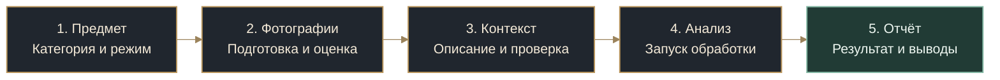
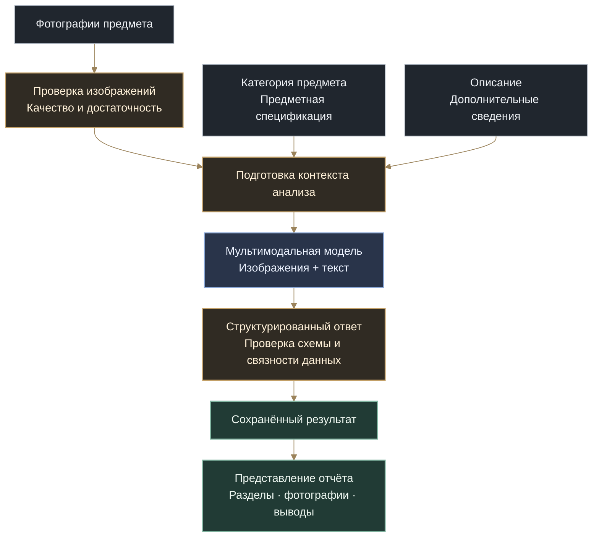
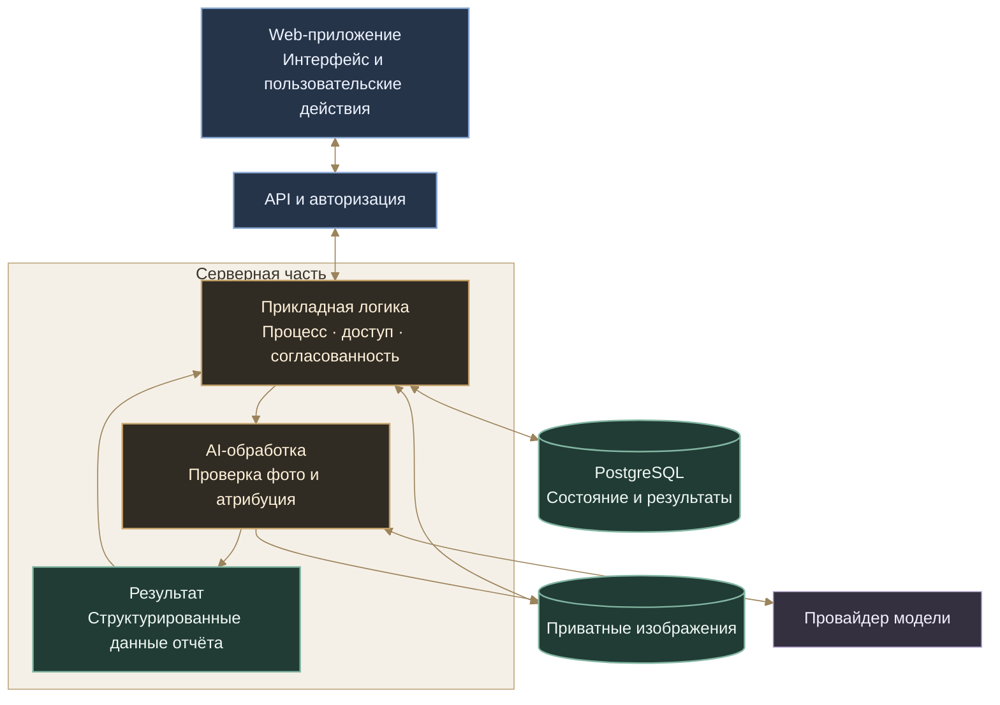
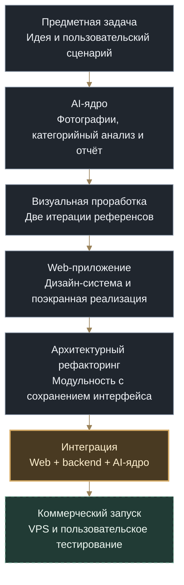

# Antique Attribution AI · устройство продукта

**От фотографий предмета — к структурированному AI-отчёту.**

[Обзор проекта](README.md) · [Сценарий](#journey) · [AI-процесс](#ai-process) · [Архитектура](#architecture) · [Путь создания](#development)

Antique Attribution AI объединяет предметный анализ, работу с изображениями и полноценное web-приложение. Пользователь последовательно подготавливает материал, получает обратную связь о фотографиях, добавляет сведения о предмете и переходит к отчёту.

Ниже показаны продуктовый сценарий и логическая архитектура объединённого сервиса. [Текущий этап разработки](README.md#status) вынесен отдельно.

---

## 1. Путь пользователя

Работа организована вокруг одного предмета: его фотографий, описания и результата. Пользователь видит последовательность действий, может возвращаться к подготовке материала и продолжать сохранённую работу.

**Подготовка фотографий.** Общий вид, детали, маркировки и состояние предмета рассматриваются как единый набор. Просмотр, поворот и обрезка встроены в рабочее пространство. Отдельная проверка качества помогает понять, достаточно ли материала и что стоит улучшить до основного анализа.

**Уточнение контекста.** Описание дополняет изображения: размеры, известная история, надписи и другие сведения помогают точнее поставить задачу. Перед запуском пользователь проверяет собранные материалы.

**Работа с результатом.** Отчёт соединяет изображения, характеристики, выводы и пояснения. История атрибуций и управляемая публикация продолжают этот сценарий: к результату можно вернуться или поделиться им.

Важный продуктовый принцип: **состав материала контролирует пользователь**. Проверка фотографий даёт рекомендации; изменение категории или выбранного набора остаётся осознанным действием.

## 2. Как устроена AI-обработка

AI-ядро разделяет оценку исходных фотографий и содержательную атрибуцию. Категория задаёт предметную структуру анализа; изображения и описание формируют контекст; ответ модели проходит программную проверку перед сохранением и представлением.

### Предметная специализация

Для разных категорий важны разные признаки. У часов — конструкция, циферблат и маркировки; у книги — издание, печать и переплёт; у иконы — изображение, материалы и техника исполнения. Общая инфраструктура анализа дополняется предметными спецификациями и типизированными форматами результата.

Такой подход позволяет расширять каталог категорий, сохраняя общий процесс работы, проверки и представления результатов.

### Управляемый процесс

Модель отвечает за анализ. Приложение — за последовательность обработки, допустимые действия, проверку полученных данных и сохранение результата. Structured Outputs дополняются серверной валидацией через Pydantic.

Результат содержит не только итоговое описание, но и наблюдаемые признаки, пояснения, степень уверенности и направления дальнейшего изучения. Отображение отчёта строится из сохранённых структурированных данных; повторное открытие не требует заново генерировать тот же текст.

## 3. Логическая архитектура

В основе — модульный Python backend с единым управлением состоянием продукта и независимым web-интерфейсом. Взаимодействие с моделью, хранение изображений и представление отчёта имеют отдельные границы ответственности.

### Web и сервер развиваются независимо

Frontend разделён на пользовательское представление, прикладное поведение и адаптеры источников данных. Это позволило отдельно проработать интерфейс, затем подключать серверные возможности, сохраняя привычные экраны и действия.

Серверная логика не привязана к конкретному клиентскому интерфейсу. Web — основа продукта; другие клиентские приложения могут использовать те же прикладные возможности через API.

### Состояние остаётся согласованным

Черновик, выбранные фотографии и результат имеют устойчивую связь. Сервер контролирует доступ и изменения, а клиент отображает подтверждённое состояние. Версии данных и явная передача редактирования защищают работу от конфликтующих действий в нескольких вкладках.

Повторная отправка команды и новое действие пользователя различаются. При потерянном ответе можно установить исход первоначальной операции, не создавая дублирующее изменение.

### Изображения отделены от способа хранения

Фотографии сохраняются приватно и выдаются после проверки доступа. Работа приложения с изображениями отделена от конкретной системы хранения. Это позволяет развивать инфраструктуру без изменения пользовательского сценария и предметной логики анализа.

### AI встроен в приложение

Провайдер модели — внешняя интеграция, а не владелец процесса. Подготовка входа, принятие результата и построение отчёта остаются в приложении. Разделение интерактивного API и длительной обработки задаёт основу дальнейшего серверного исполнения.

## 4. Инженерные акценты

| Задача | Подход | Практический смысл |
|---|---|---|
| Подготовить материал для анализа | Отдельный этап проверки фотографий и явное дополнение контекста | Пользователь получает обратную связь до основного запуска |
| Работать с разными категориями | Общее AI-ядро и предметные спецификации | Новые типы дополняют систему, а не требуют отдельного приложения |
| Сделать результат пригодным для продукта | Типизированный ответ, серверная валидация, отдельное представление отчёта | Данные можно последовательно сохранять, отображать и использовать в разных экранах |
| Сохранить разработанный интерфейс | Разделение представления, прикладного поведения и источников данных | Backend подключается без повторного проектирования всего Web |
| Обрабатывать повторы и конфликты | Идентичность команд, версии состояния и контроль редактора | Потеря ответа или старая вкладка не превращаются в неконтролируемое изменение |
| Проверять изменения | Контрактные, интеграционные и браузерные сценарии; ручная приёмка | Проверяется не только основной путь, но и восстановление после ошибок |

## 5. От идеи к коммерческому продукту

Идея выросла из моего практического опыта работы с антиквариатом: для незнакомого предмета нужно собрать признаки, сопоставить фотографии и сведения, затем получить понятное исходное описание. Я последовательно развил эту задачу от AI-ядра до самостоятельного web-продукта.

**Ядро.** Выделены подготовка фотографий, проверка качества, предметный анализ, структура результата и рендеринг отчёта. Категории развиваются поверх общей инфраструктуры.

**Визуальная система и Web.** До реализации были проработаны сценарии и две версии экранных референсов. Затем созданы дизайн-система, рабочее пространство и связанные поверхности продукта.

**Рефакторинг.** Уже собранное приложение прошло отдельную архитектурную переработку. Основная задача — разделить ответственность, управление состоянием и внешние зависимости, сохранив интерфейс, переходы и пользовательское поведение.

**Интеграция и запуск.** Следующий результат этой работы — единый сервис, в котором Web, серверное состояние и AI-обработка соединены через согласованные прикладные границы. Развёртывание на VPS продолжает ту же архитектуру.

## 6. Авторство и AI-assisted разработка

Проект создаю самостоятельно с использованием ИИ-инструментов — от идеи и предметной постановки до архитектуры, интерфейса, реализации и проверки результата.

В моей зоне ответственности: продуктовый сценарий, требования, архитектурные решения, визуальные референсы и дизайн-система, декомпозиция работы, организация AI-assisted реализации, review и ручная приёмка. ИИ используется для анализа вариантов, написания кода, тестов и локальных исправлений; направление проекта и принятие решений остаются за мной.

Один из результатов этого подхода — возможность последовательно перерабатывать сложное приложение, не теряя первоначальный замысел и согласованное поведение. Процесс организации такой разработки отдельно представлен в [Command Center](https://github.com/Vkuvalin/command-center-public).

---

**Автор:** [Владислав Кувалин](https://github.com/Vkuvalin). Репозиторий представляет коммерческий проект; исходный код и внутренняя документация остаются закрытыми.

[К обзору проекта](README.md) · [Наверх](#top)
