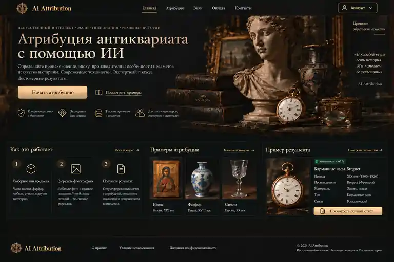
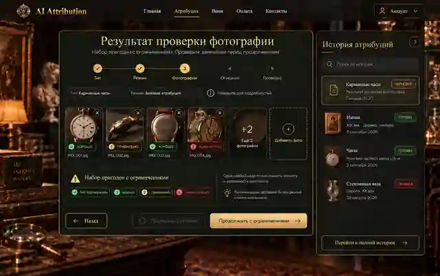
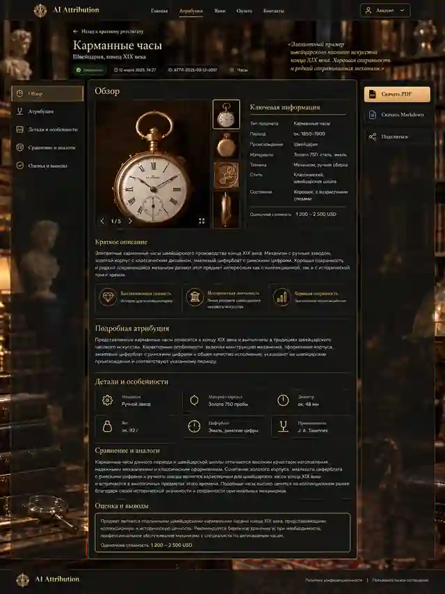

# Antique Attribution AI

**AI-атрибуция антикварных и коллекционных предметов по фотографиям и описанию.**

 

[Продукт](#product) · [Интерфейс](#interface) · [Устройство и схемы](PRESENTATION.md) · [Путь создания](PRESENTATION.md#development) · [Мой вклад](#ownership)

---

## От предмета — к понятному отчёту

У антикварного предмета часто нет полного описания. Фотографии показывают форму, материалы, детали и маркировки; сведения о происхождении, времени создания и назначении приходится собирать и сопоставлять.

**Antique Attribution AI организует эту работу в последовательный web-сценарий:** подготовка фотографий, оценка их пригодности, дополнение контекста, категорийный мультимодальный анализ и подробный структурированный отчёт.

Продукт ориентирован на коллекционеров, исследователей и людей, работающих с антиквариатом. Результат даёт исходное понимание предмета, поясняет наблюдаемые признаки и помогает определить направления дальнейшего изучения.

**Категория → фотографии и проверка → описание → AI-анализ → отчёт.**

| Часть продукта | Что получает пользователь |
|---|---|
| **Рабочее пространство** | Последовательную подготовку материалов с возможностью вернуться к предыдущим шагам и продолжить работу |
| **Фотографии и обратная связь** | Просмотр и редактирование снимков, оценку качества и рекомендации перед основным анализом |
| **Категорийный анализ** | Предметный подход к разным типам антиквариата: от часов и книг до икон, украшений и стекла |
| **Подробный отчёт** | Изображения, характеристики, выводы и пояснения в единой структуре |
| **Дальнейшая работа с результатом** | Историю атрибуций и управляемое представление отчёта по ссылке |

## Интерфейс

Визуальная система сочетает антикварную предметную среду с рабочим интерфейсом: тёмные поверхности, тёплые акценты, крупные изображения и последовательную подачу материала.

*Визуальные референсы интерфейса. Данные на экранах демонстрационные.*

### Главная страница

  

<strong>Рабочее пространство · результат проверки фотографий</strong>

Проверка набора изображений, обратная связь и переход к дальнейшей подготовке материала.

  

<strong>Финальный отчёт · форма представления результата</strong>

Фотографии, характеристики и пояснения собраны в единый документ с последовательными разделами.

  

## Инженерная основа

**AI внутри управляемого процесса.** Подготовка входа, проверка фотографий, атрибуция, валидация и представление результата разделены. Модель выполняет анализ; приложение управляет состоянием, допустимыми действиями и сохранением результата.

**Расширяемое предметное ядро.** Общая инфраструктура использует спецификации отдельных категорий и типизированные форматы ответа. Расширение каталога не требует заново создавать пользовательский процесс.

**Самостоятельный Web и модульный backend.** Интерфейс, прикладное поведение и источники данных разделены. Это позволяет подключать серверные возможности с сохранением разработанного пользовательского опыта и развивать клиентские приложения вокруг общего API.

**Согласованность данных и приватные фотографии.** Сервер контролирует доступ, изменения и право редактирования. Повторы команд и потерянные ответы обрабатываются отдельно от новых действий, а изображения сохраняются в отдельном приватном хранилище.

**Проверяемая разработка.** Контрактные, интеграционные и браузерные сценарии дополняются ручной приёмкой. Среди проверяемых случаев — повтор команды, конфликт редакторов, восстановление сохранённой работы и некорректный ответ модели.

[Пользовательский путь, AI-процесс и архитектура на схемах →](PRESENTATION.md)

## Технологии

| Область | Основа |
|---|---|
| **AI и данные результата** | Мультимодальные LLM, Structured Outputs, Pydantic, категорийные спецификации |
| **Backend** | Python, FastAPI, Uvicorn, SQLAlchemy Async, PostgreSQL, Alembic |
| **Web** | HTML, CSS, JavaScript; модульное многостраничное приложение и собственная дизайн-система |
| **Доступ и изображения** | Yandex ID, серверные сессии, проверки доступа, приватное хранение фотографий |
| **Проверки** | pytest, Playwright, контрактные и интеграционные тесты, Ruff, Pyright |

## Мой вклад

**Самостоятельно создаю продукт с использованием ИИ-инструментов — от идеи до подготовки коммерческого запуска.** Идея выросла из моего практического опыта работы с антиквариатом.

Я определил пользовательский сценарий и требования, проработал AI-ядро, подготовил две версии визуальных референсов и дизайн-систему, организовал поэкранную реализацию Web и его отдельный архитектурный рефакторинг с сохранением интерфейса и поведения.

Моя работа включает архитектурные решения, декомпозицию и управление AI-assisted реализацией, review изменений, проверку интеграций и ручную приёмку. ИИ используется в разработке кода, тестов и исправлений; продуктовые решения и ответственность за итог остаются за мной.

**Пройденный путь:** идея → AI-ядро → визуальные референсы → дизайн-система → Web → архитектурный рефакторинг → интеграция и подготовка запуска.

[Подробнее осоздании проекта →](PRESENTATION.md#development) · [Command Center — организация AI-assisted разработки](https://github.com/Vkuvalin/command-center-public)

## Текущий этап

Разработаны AI-ядро и web-приложение. Сейчас выполняются их интеграция с серверной частью и подготовка к развёртыванию на VPS и коммерческому запуску.

---

**Это публичная презентация коммерческого проекта.** Исходный код, предметные промпты и внутренняя документация остаются закрытыми. Действующее приложение и инженерные решения демонстрирую на собеседовании.

**Автор:** [Владислав Кувалин](https://github.com/Vkuvalin)

[Устройство продукта](PRESENTATION.md) · [Наверх](#top)
